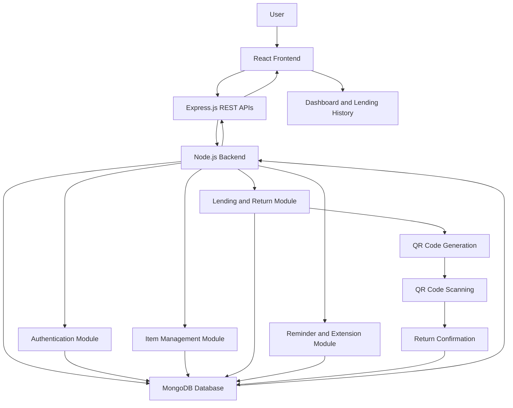

# WhoHasIt?

**Lend it. Track it. Get it back.**

## 1. Project Description

WhoHasIt? is a web-based application that helps users keep track of items they lend to friends, classmates, roommates, or colleagues. It records who borrowed an item, when it was borrowed, and when it is expected to be returned.

The application provides a simple way to manage lending records, track overdue items, request extensions, and confirm the return of borrowed belongings.

## 2. Problem Statement

People often lend personal belongings such as books, chargers, notes, tools, and other items to others. They may forget who borrowed an item, when it was lent, or when it should be returned. Verbal agreements and informal messages can make it difficult to maintain accurate records and follow up on pending returns.

There is a need for a simple and organized system that helps users record lending activities, track return deadlines, and confirm that items have been returned.

## 3. Target Users

- Students who lend books, notes, stationery, and electronic accessories.
- Friends and roommates who share personal belongings.
- Families who share household items.
- Small teams and offices that lend equipment among members.

## 4. Existing Solutions

### 4.1 Lend-Items

Website: https://www.lend-items.com/

Lend-Items is an online service related to lending and sharing items. It serves as a reference for exploring how lending activities and item information can be managed digitally.

### 4.2 MyStuff2 Pro

Website: https://www.mystuff2app.com/

MyStuff2 Pro is an application for organizing and tracking personal belongings. It serves as a reference for item organization and record management.

## 5. Proposed Solution and Innovation

WhoHasIt? proposes a centralized platform for managing personal lending records. Users can add items, record lending transactions, set expected return dates, and monitor the status of borrowed belongings.

The main innovation is a **two-way confirmation system** that allows the borrower to acknowledge receiving an item and both parties to confirm its return. This helps maintain a clearer record of lending activities and reduces confusion between users.

The application will also support return reminders, extension requests, overdue tracking, and lending history.

## 6. MVP Features

The Minimum Viable Product (MVP) will include the following features:

- **User Registration and Login:** Allow users to create accounts and securely access their records.
- **Dashboard:** Display lent items, borrowed items, upcoming returns, and overdue items.
- **Item Management:** Add, update, view, and manage personal items.
- **Lending Records:** Record the item, borrower, lending date, and expected return date.
- **Borrower Acknowledgement:** Allow borrowers to confirm that they have received an item.
- **Return Tracking:** Allow the borrower to mark an item as returned and the lender to confirm its receipt.
- **Return Reminders:** Highlight items approaching their expected return dates.
- **Extension Requests:** Allow borrowers to request additional time to return an item.
- **Lending History:** Maintain a record of completed and pending lending transactions.
- **Status Tracking:** Identify items as pending acknowledgement, lent, due soon, overdue, or returned.

## 7. Technology Stack

The project will initially use the MERN stack. The technology stack may be modified as needed during development, while keeping the project requirements and final demonstration in mind.

| Technology | Purpose |
|---|---|
| MongoDB | Store user accounts, item details, and lending records. |
| Express.js | Build backend APIs and handle application requests. |
| React.js | Develop the user interface and interactive components. |
| Node.js | Run the backend application. |
| HTML5 | Structure web pages. |
| CSS3 | Style the application and make it responsive. |
| JavaScript | Implement frontend and backend functionality. |
| Git and GitHub | Version control, collaboration, and project management. |

Additional technologies may be introduced for authentication, input validation, notifications, and deployment as development progresses.

## 8. Architectural Flow Diagram

